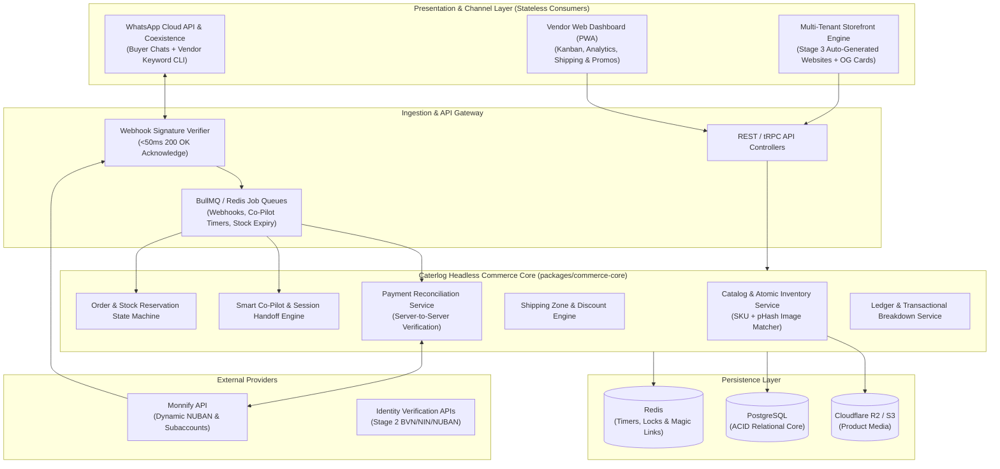

# Caterlog (Duka)

**Commerce Infrastructure for Chat-First African Vendors**

[-blue)](#8-implementation-roadmap--repository-status)
[](#3-system-architecture)
[](#5-database-schema--monetary-integrity)

> *"We don't want to build the next marketplace. We want to give every existing WhatsApp and Instagram vendor the commerce backend of a real marketplace — without asking them to change how they sell."*

---

## Table of Contents

1. [Overview & Core Value Proposition](#1-overview--core-value-proposition)
2. [The 6-Layer Platform Architecture](#2-the-6-layer-platform-architecture)
3. [System Architecture & Topology](#3-system-architecture--topology)
4. [How the WhatsApp & Co-Pilot Engine Works](#4-how-the-whatsapp--co-pilot-engine-works)
5. [Dual-Access Vendor Management (WhatsApp Keywords + Web Dashboard)](#5-dual-access-vendor-management-whatsapp-keywords--web-dashboard)
6. [Repository Structure (Monorepo Map)](#6-repository-structure-monorepo-map)
7. [Database Schema & Monetary Integrity](#7-database-schema--monetary-integrity)
8. [Quick Start & Testing with Your WhatsApp](#8-quick-start--testing-with-your-whatsapp)
9. [Implementation Roadmap & Repository Status](#9-implementation-roadmap--repository-status)
10. [Documentation Index](#10-documentation-index)

---

## 1. Overview & Core Value Proposition

Most retail commerce in Nigeria and across Africa happens inside **WhatsApp chats, WhatsApp Status replies, and Instagram DMs**—not on traditional e-commerce websites. Vendors post product photos, buyers ask *"How much?"* or *"Send account,"* payments happen via bank transfer, and vendors track stock and orders in their heads or notebooks.

**Caterlog (Duka)** drops an automated transaction, inventory, and verification layer directly into the conversations vendors are already having:
- **In-Chat Bank Transfer Automation:** Generates dynamic 10-digit NUBAN virtual accounts (via Monnify) directly inside WhatsApp, verifies bank transfers server-to-server, and pushes `PAID` receipts back into the chat thread.
- **Smart Co-Pilot (Autonomous Idle Takeover):** If a vendor is online/away (e.g., in traffic, packing orders, or sleeping) and doesn't reply within a configurable window (default `60s`), Caterlog steps in automatically—matching WhatsApp Status product photos, quoting live stock and shipping fees, and closing the sale end-to-end.
- **Dual-Access Operations:** Vendors can run their entire store (check revenue breakdowns, set shipping fees, create discount codes, update stock, track pending transfers) either via **WhatsApp Keyword Commands** or through the **Mobile-First Web Dashboard**.
- **Zero-Setup Auto-Generated Website:** Because Layer 1 structures the vendor's catalog, prices, photos, shipping zones, and best-sellers as a byproduct of chat sales, Caterlog can automatically generate a live, synchronized e-commerce website for the vendor with zero data re-entry.

---

## 2. The 6-Layer Platform Architecture

Caterlog is designed as six compounding layers. A vendor can stop at Layer 1 and immediately run a better business; each subsequent layer consumes the data generated by the layer beneath it.

| Layer | Name | Summary | Monetization Role |
| :--- | :--- | :--- | :--- |
| **Layer 1** | **Chat Commerce Core** | In-chat virtual account generation, Smart Co-Pilot idle takeover, WhatsApp Status image matching, atomic stock locks, and Dual-Access Dashboard. | Free / Low-friction acquisition engine that captures structured catalog & order data. |
| **Layer 2** | **Verification & Trust** | NDPR-compliant BVN/NIN/NUBAN identity verification and tamper-evident server-rendered Verified Seller badges in chat & checkout. | Increases buyer conversion across strangers and establishes platform trust. |
| **Layer 3** | **Auto-Generated Website** | Instant, live multi-tenant storefront generated automatically from Layer 1 catalog, shipping, and order data. | Primary recurring SaaS subscription revenue. |
| **Layer 4** | **Progressive Design Tiers** | **Standard** (category-matched templates), **Guided** (safe token customizer), and **Custom** (rapid bespoke design built on `@caterlog/storefront-ui`). | High-margin premium subscription & one-time bespoke design tier. |
| **Layer 5** | **Multi-Channel Sync** | Single source of truth for inventory across WhatsApp, Instagram, and Web Storefront + Unified Order Inbox. | Core retention lock-in (eliminates cross-channel overselling). |
| **Layer 6** | **Intelligence & Financing** | Anonymized informal retail demand intelligence + consent-based verified revenue history for licensed lending partners. | Post-scale B2B data licensing & financing referral revenue. |

---

## 3. System Architecture & Topology

Caterlog follows a **Headless Modular Monolith** architecture backed by an **Asynchronous Idempotent Webhook Pipeline** and a **Multi-Tenant Storefront Rendering Engine**.



### Non-Negotiable Architectural Principles
1. **Strict Headless Separation:** Domain logic in `packages/commerce-core` has zero dependency on HTTP, WhatsApp message templates, or React components.
2. **Server-Verified State Machine:** Orders never transition to `PAID` based on client redirects. Payment state changes require both a valid provider HMAC webhook signature and an independent server-to-server `GET /transactions/{ref}` verification call.
3. **Kobo-Only Financial Math:** All currency fields (`basePriceKobo`, `shippingFeeKobo`, `discountAmountKobo`, `totalAmountKobo`, `amountPaidKobo`) are stored and calculated as integer kobo (`₦1.00 = 100 kobo`) to eliminate floating-point rounding bugs.

---

## 4. How the WhatsApp & Co-Pilot Engine Works

Unlike Telegram, WhatsApp does not allow third-party inline bots inside personal chats, and Nigerian vendors refuse to give up their WhatsApp Business mobile app. Caterlog solves this using:

1. **Meta WhatsApp Business App Coexistence + Companion Bot:** Vendors keep using their WhatsApp Business mobile app while Caterlog receives real-time `messages` and `message_echoes` webhooks on the backend.
2. **Smart Co-Pilot (Idle Detection & Autonomous Closing):**
   - Tracks `lastVendorMessageAt` per conversation thread.
   - In **`COPILOT` mode** (default `60s`, vendor-editable), if a buyer asks about a product and the vendor is busy/inactive for 60 seconds, Caterlog automatically steps in, checks stock, collects delivery zone via native WhatsApp Flows, generates a dynamic Monnify 10-digit account, and reconciles payment.
   - Also supports **`FULL_AUTO` mode** (`<2s` instant response) and **`MANUAL` mode**.
3. **WhatsApp Status Auto-Matching (`pHash`):**
   - When a vendor uploads a product photo, Caterlog stores a 64-bit perceptual image hash (`imagePhash`).
   - When a buyer swipes up on a vendor's WhatsApp Status photo and replies *"How much?"*, Caterlog matches the quoted image hash against the catalog in `<10ms` and replies with the exact price, remaining stock, and checkout button.
4. **In-Chat Dynamic NUBAN Generation & Copyable Bubble:**
   - Generates a time-bound Monnify invoice virtual account (default `15 mins`, vendor-editable) and locks the inventory in `StockReservation`.
   - Sends the formatted invoice followed immediately by a message bubble containing **only** the 10-digit account number so the buyer can 1-tap copy and paste into OPay, Moniepoint, Kuda, or GTBank.
   - Automatically handles **Exact Payments**, **Overpayments**, and **Partial Payments** (e.g., if a buyer forgets to include the shipping fee, Caterlog marks the order `PARTIALLY_PAID`, extends the stock lock, and prompts the buyer for the exact balance).

---

## 5. Dual-Access Vendor Management (WhatsApp Keywords + Web Dashboard)

Vendors can manage their entire store from **WhatsApp Keywords** when on the go, or hop into the **Web Dashboard** via a passwordless 1-tap magic link (`dashboard`). Both surfaces invoke the exact same `commerce-core` methods:

| Feature | WhatsApp Keyword Command (Vendor Chat) | Web Dashboard Equivalent |
| :--- | :--- | :--- |
| **Passwordless Login** | `dashboard` or `login` *(returns 15m Magic Link)* | WhatsApp OTP / Magic Link Login |
| **Revenue & Breakdown** | `sales`, `sales today`, `sales week`, `sales month` | Interactive Revenue Charts, Channel Split & Ledger Export |
| **Add / Update Product** | Send Photo + Caption: `Zara Heel, 25000, stock 5` | Catalog Manager UI & Bulk Editor |
| **Update Stock** | `stock SHOE-01 10` *(or reply `stock 10` to photo)* | Inline Inventory Counter |
| **Shipping Zones** | `shipping`, `ship Ibadan #6000`, `shipping add Lekki 3500`, `shipping delete 2` | Shipping Matrix & Delivery Rate Builder |
| **Discounts & Promos** | `discount`, `disc VIP #5000`, `discount add PAYDAY 10%`, `discount end PAYDAY` | Promotions & Flash Sale Manager |
| **Pending & Paid Orders** | `pending`, `paid`, `remind ORD-882` | Live Order Kanban (`Pending` → `Paid` → `Dispatched`) |
| **Mark Dispatched** | `dispatch ORD-882 08031112222` | `[Mark Dispatched]` Modal + Automated Buyer Alert |
| **Co-Pilot Mode & Delay** | `mode copilot`, `mode copilot 90s`, `mode auto`, `mode off` | Top-Bar Co-Pilot Status Toggle & Timer Slider |
| **Stock Hold Timer** | `hold 20` *(sets transfer reservation window to 20 mins)* | Store Settings -> Stock Reservation TTL |

---

## 6. Repository Structure (Monorepo Map)

```text
caterlog/
├── apps/
│   ├── api/                 # Stage 1.4 HTTP API, WhatsApp/Monnify Webhooks, Co-Pilot Engine & OG Card Renderer
│   ├── dashboard/           # Stage 1.5 Next.js + TypeScript Vendor Command Dashboard & Live Simulator
│   └── storefront/          # (Stage 3 — Deferred) Multi-Tenant Vendor Website & Hosted Checkout Engine
├── packages/
│   ├── database/            # Stage 1.1 Prisma PostgreSQL Schema, Migrations & Seed Data
│   ├── commerce-core/       # Stage 1.2 Pure Hexagonal Domain (domain/, ports/, services/, commands/)
│   ├── integrations/        # Stage 1.3 Monnify Virtual Account + WhatsApp Cloud API Adapters
│   ├── shared/              # Framework-free money utilities shared by domain & persistence layers
│   └── storefront-ui/       # (Stage 3/4 — Deferred) Internal Design System SDK
├── docs/
│   ├── PLATFORM_CONCEPT.md       # Full 6-Layer Platform Vision & Business Model Specification
│   ├── STAGE_1_SPEC.md           # Stage 1 Technical Specification, ER Diagram & API/Keyword Contracts
│   └── WHATSAPP_TESTING_GUIDE.md # Step-by-Step Guide to Testing with Simulator or Physical WhatsApp Phone
└── README.md                     # Living Repository Architecture & Status Guide (Updated Continuously)
```

---

## 7. Database Schema & Monetary Integrity

The PostgreSQL database (defined in `packages/database/prisma/schema.prisma`) comprises **14 core tables**:
- **Identity & Compliance:** `Vendor`, `VendorConsent` (NDPR opt-in audit trail).
- **Catalog & Inventory:** `Product` (with `imagePhash`, `stockTotal`, `stockReserved`), `ProductVariant`.
- **Pricing Rules:** `ShippingZone`, `Discount`.
- **Orders & Locks:** `Customer`, `Order`, `OrderItem`, `StockReservation` (configurable TTL, default `15 mins`).
- **Payments & Reconciliation:** `PaymentInvoice` (Monnify 10-digit NUBAN), `PaymentTransaction` (idempotent + server-verified proof).
- **Automation & Audit:** `ChatSession` (Co-Pilot idle tracking), `CommerceEvent` (append-only ledger for analytics and Stage 6 financing).

For full field-by-field definitions and state machine rules, see [`docs/STAGE_1_SPEC.md`](docs/STAGE_1_SPEC.md).

---

## 8. Quick Start & Testing with Your WhatsApp

### Run All Unit & End-to-End Synchronization Tests
```bash
npm test
```

### Typecheck the Workspace & Build the Dashboard
```bash
npm run typecheck
npm run build
```

### Choose In-Memory Demo or PostgreSQL Persistence
The API runs in `DATA_MODE=memory` by default, using seeded demo data with no database needed. To persist vendors, products, stock, orders and payments in PostgreSQL:

```bash
# 1. Point DATABASE_URL at Neon, Supabase or a local Postgres instance
#    (see .env.example), then apply the schema and seed the demo vendor.
npm run db:generate
npm run db:migrate     # local development (prisma migrate dev)
npm run db:seed

# 2. Start the API against PostgreSQL
DATA_MODE=database npm run dev:api
```

For a hosted/staging database use `npm run db:deploy` instead of `db:migrate`; it applies the committed migrations without the interactive dev prompts.

`PERSISTENCE_VENDOR_SLUG` selects which seeded vendor to hydrate (default `amaka-shoes`). On startup the engine loads that vendor plus its products, zones, discounts and recent orders, then mirrors every subsequent mutation through Prisma. `GET /health` reports the active `dataMode`, and `/api/v1/integrations/status` stays unchanged.

> **Persistence slice scope:** the write-through store covers vendor settings, catalog, stock, discounts, shipping zones, order creation, payment reconciliation (idempotent by `providerTransactionRef`), reservation expiry and dispatch. Auth/multi-tenancy, durable background workers and webhook replay protection are the next backend slice.

### Start the API, Webhook Server & Vendor Command Dashboard
```bash
npm run dev
```
This starts both processes together:
- **API & webhooks:** [http://localhost:4000](http://localhost:4000) — the root redirects to the dashboard.
- **Next.js Vendor Dashboard:** [http://localhost:3000](http://localhost:3000)

Run them separately when needed with `npm run dev:api` and `npm run dev:dashboard`. The API loads the root `.env` automatically when present. The dashboard reads `NEXT_PUBLIC_API_BASE_URL` at build time (set it in `apps/dashboard/.env.local`; default `http://localhost:4000`).

Open the dashboard to:
- **Manage live orders:** test full or partial Monnify transfers, expire an unpaid reservation and release stock, or mark a paid order dispatched.
- **Manage catalog:** add products, update stock inline, and preview the live Dynamic OpenGraph Product Card (`/og/product/SHOE-01`).
- **Manage shipping & discounts:** add/remove delivery zones and promo codes.
- **Configure automation:** Co-Pilot Mode, idle takeover timer (`default 60s`), and stock hold TTL (`default 15m`).
- **Use the Live WhatsApp Dual-Thread Simulator:** send any Vendor Keyword (`sales`, `shipping add Ikoyi 4000`, `discount add FLASH 15%`, `stock SHOE-01 12`, `mode copilot 90s`, `hold 20`, `dashboard`) or Buyer WhatsApp Status reply and watch the dashboard synchronize in real time over Server-Sent Events (SSE).

### Connect Your Physical WhatsApp Phone (5-Minute Setup)
See **[`docs/WHATSAPP_TESTING_GUIDE.md`](docs/WHATSAPP_TESTING_GUIDE.md)** for the step-by-step instructions to expose `http://localhost:4000/webhooks/whatsapp` via `cloudflared` or `ngrok` and connect Meta's free WhatsApp Cloud API Test Number to your personal phone.

---

## 9. Implementation Roadmap & Repository Status

This table tracks the live engineering progress of the repository and is updated as each module is built and verified:

| Stage / Module | Status | Description |
| :--- | :---: | :--- |
| **Architecture & Stage 1 Specification** | ✅ Completed | System architecture, ER schema, Co-Pilot rules, and Dual-Access spec (`docs/STAGE_1_SPEC.md`). |
| **Stage 1.1 — Monorepo & Database (`packages/database`)** | ✅ Completed | Workspace config, `docker-compose.yml`, 14-table Prisma PostgreSQL schema, kobo utilities, and Nigerian vendor seed script. |
| **Stage 1.2 — Commerce Core (`packages/commerce-core`)** | ✅ Completed | Hexagonal domain core (`domain/`, `ports/`, `services/`, `commands/`), atomic stock locks, partial/full payment reconciliation, and WhatsApp keyword parser. |
| **Stage 1.3 — Integrations (`packages/integrations`)** | ✅ Completed | Monnify Dynamic 10-digit NUBAN & Server Verification adapter + WhatsApp Cloud API & 1-tap copyable NUBAN bubble sender. |
| **Stage 1.4 — API & Co-Pilot Engine (`apps/api`)** | ✅ Completed | Webhook endpoints (`/webhooks/whatsapp`, `/webhooks/monnify`), HMAC verification, Co-Pilot idle timer, reservation-expiry sweep, Dynamic OG Card (`/og/product/:sku`), and SSE sync API. |
| **Stage 1.5 — Vendor Command Dashboard (`apps/dashboard`)** | ✅ Completed | Next.js 16 + TypeScript + Tailwind dashboard with orders, catalog, shipping, discounts, OG card preview, and a dual WhatsApp live simulator over SSE. |
| **Stage 2 — Verification & Trust Layer** | ⏳ Next Up | BVN/NIN/NUBAN verification adapter, encrypted identity hash, appeals flow, and tamper-evident Verified Seller badges. |
| **Stage 3+ — Auto-Generated Storefront (`apps/storefront`)** | 📋 Deferred | Multi-tenant vendor websites & `@caterlog/storefront-ui` design system (deferred until Stage 1–2 are verified). |

> **Stage 1 runtime note:** the API defaults to `DATA_MODE=memory`, an in-memory single-vendor runtime with seeded demo data. Set `DATA_MODE=database` to hydrate the same engine from PostgreSQL and write every mutation through Prisma (`apps/api/src/persistence/`). The schema/migration and seed are ready. Durable background workers, multi-tenant auth/magic-link sessions and the live WhatsApp media-download/pHash pipeline are the next implementation slice.

---

## 10. Documentation Index

- **[`docs/PLATFORM_CONCEPT.md`](docs/PLATFORM_CONCEPT.md):** Complete product vision, 6-layer strategy, architectural principles, and business model.
- **[`docs/STAGE_1_SPEC.md`](docs/STAGE_1_SPEC.md):** Stage 1 technical specification, Prisma database schema, Redis/BullMQ queue design, and WhatsApp keyword-to-API mapping.
- **[`docs/WHATSAPP_TESTING_GUIDE.md`](docs/WHATSAPP_TESTING_GUIDE.md):** Step-by-step guide to testing Caterlog using the built-in browser simulator or connecting your physical WhatsApp phone via Meta's free Test Number.
